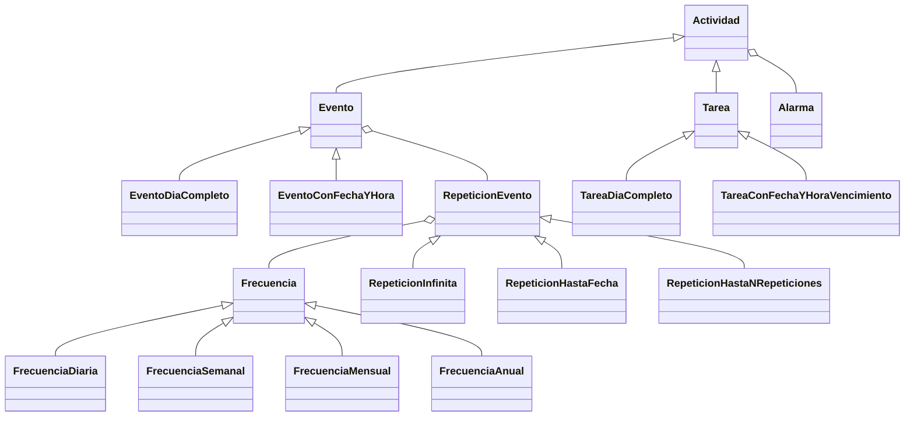

# Calendario de Eventos y Tareas

Aplicación de escritorio en **Java** con interfaz gráfica en **JavaFX** para gestionar eventos y tareas,
con repeticiones, alarmas y guardado automático del calendario.

Proyecto desarrollado para la materia Algoritmos y Programación III (FIUBA), con foco en programación
orientada a objetos, patrones de diseño y testing.

## Funcionalidades

- **Eventos y tareas**: de día completo o con fecha y hora específicas. Las tareas tienen fecha de vencimiento.
- **Repeticiones**: frecuencia diaria, semanal, mensual o anual, sin fin, hasta una fecha o durante una cantidad de repeticiones.
- **Alarmas**: se configuran en minutos de anticipación o para un momento fijo, y se reprograman solas si cambia la fecha u horario de la actividad.
  Cuando una alarma se activa, la aplicación muestra una notificación.
- **Vistas por día, semana y mes**, con ventanas para agregar eventos y tareas.
- **Persistencia**: el calendario se serializa a un archivo (`calendario.dat`) y se carga al iniciar la aplicación.

## Diseño

- **Herencia y polimorfismo** para modelar las actividades y sus variantes:



- **Frecuencias y tipos de repetición intercambiables**: cada evento delega en un objeto `RepeticionEvento`, que a su vez usa una `Frecuencia`.
  Así se puede cambiar la regla de repetición sin modificar la clase del evento.
- **MVC**: el modelo (`Calendario` y las actividades) está separado de las vistas (`Vista*`, archivos `.fxml`)
  y de los controladores (`Controlador*`), que conectan las acciones del usuario con el modelo.
- **Patrón Observer**: `Calendario` es observable y notifica a la vista principal cuando se activa una alarma,
  sin que el modelo dependa de la interfaz gráfica.
- **Excepciones propias** (`CalendarioNoGuardadoException`) para los errores de persistencia.

## Tecnologías

- Java 20, JavaFX 20, ControlsFX y JFXtras
- JUnit 4 para los tests unitarios
- Maven para la compilación y las dependencias

## Cómo ejecutarlo

Requisitos: **JDK 20 o superior** y **Maven**. JavaFX lo descarga Maven, no hace falta instalarlo aparte.

```bash
# Ejecutar la aplicación
mvn javafx:run

# Ejecutar los tests
mvn test
```

La primera vez se crea un calendario vacío; al agregar eventos o tareas se guarda en `calendario.dat`.

## Desarrollo por etapas

El proyecto se hizo en etapas, cada una desarrollada en su propia rama:

1. **Etapa 1**: modelo de eventos, tareas, repeticiones y alarmas, con tests.
2. **Etapa 2**: persistencia del calendario.
3. **Etapa 3**: interfaz gráfica en JavaFX y patrón Observer para las alarmas.
