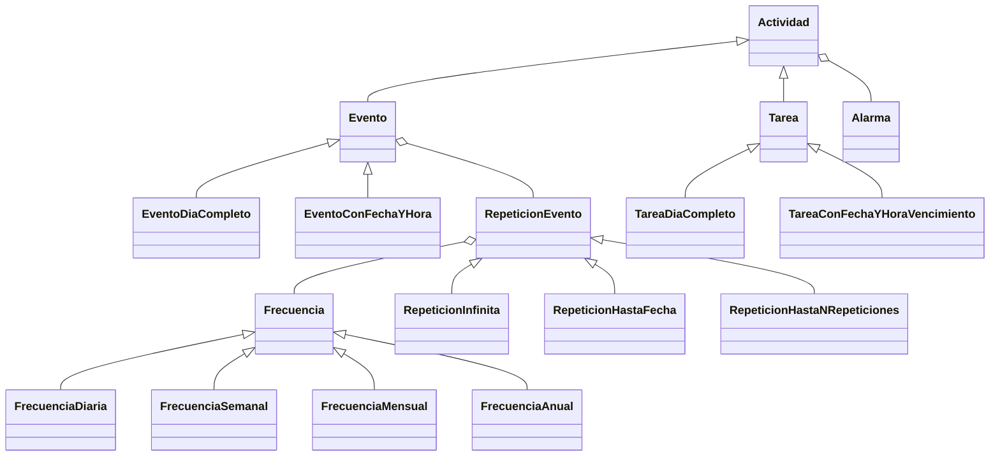

# Calendario de Eventos y Tareas

Aplicación de escritorio en **Java** con interfaz gráfica en **JavaFX** para gestionar eventos y tareas,
con repeticiones, alarmas y guardado automático del calendario.

Proyecto desarrollado para la materia Algoritmos y Programación III (FIUBA), con foco en programación
orientada a objetos, patrones de diseño y testing.

## Funcionalidades

- **Eventos y tareas**: de día completo o con fecha y hora específicas. Las tareas tienen fecha de vencimiento.
- **Repeticiones**: frecuencia diaria, semanal, mensual o anual, sin fin, hasta una fecha o durante una cantidad de repeticiones.
- **Alarmas**: se configuran en minutos de anticipación o para un momento fijo, y se reprograman solas si cambia la fecha u horario de la actividad.
  Cuando una alarma se activa, la aplicación muestra una notificación.
- **Vistas por día, semana y mes**, con ventanas para agregar eventos y tareas.
- **Persistencia**: el calendario se serializa a un archivo (`calendario.dat`) y se carga al iniciar la aplicación.

## Diseño

- **Herencia y polimorfismo** para modelar las actividades y sus variantes:



- **Frecuencias y tipos de repetición intercambiables**: cada evento delega en un objeto `RepeticionEvento`, que a su vez usa una `Frecuencia`.
  Así se puede cambiar la regla de repetición sin modificar la clase del evento.
- **MVC**: el modelo (`Calendario` y las actividades) está separado de las vistas (`Vista*`, archivos `.fxml`)
  y de los controladores (`Controlador*`), que conectan las acciones del usuario con el modelo.
- **Patrón Observer**: `Calendario` es observable y notifica a la vista principal cuando se activa una alarma,
  sin que el modelo dependa de la interfaz gráfica.
- **Excepciones propias** (`CalendarioNoGuardadoException`) para los errores de persistencia.

## Tecnologías

- Java 20 (compila con `release 20`), JavaFX 21, ControlsFX y JFXtras
- JUnit 4 para los tests unitarios
- Maven para la compilación y las dependencias

## Instalación

### Requisitos

| Herramienta | Versión | Para qué |
|---|---|---|
| JDK | 20 o superior (recomendado: 21 LTS) | Compilar y ejecutar |
| Maven | 3.9 o superior | Dependencias, build y tests |
| Git | cualquiera | Clonar el repositorio |

JavaFX, ControlsFX y JFXtras los descarga Maven automáticamente: no hace falta instalarlos aparte.

### 1. Instalar el JDK

**Windows** (con winget, desde PowerShell):

```powershell
winget install --id EclipseAdoptium.Temurin.21.JDK -e
```

También se puede descargar el instalador `.msi` de [Adoptium](https://adoptium.net/temurin/releases/?version=21).
Durante la instalación conviene activar la opción **Set JAVA_HOME variable**.

**macOS** (con Homebrew):

```bash
brew install --cask temurin@21
```

**Linux** (Debian/Ubuntu):

```bash
sudo apt install openjdk-21-jdk
```

### 2. Instalar Maven

**Windows**: elegí una de estas opciones (winget no incluye Maven).

- **Con Chocolatey**: desde una PowerShell abierta **como administrador**:

  ```powershell
  choco install maven -y
  ```

- **Manual, sin permisos de administrador**:
  1. Descargá el archivo `apache-maven-<versión>-bin.zip` desde la [página de descargas de Maven](https://maven.apache.org/download.cgi).
  2. Descomprimilo, por ejemplo, en `C:\Users\<tu-usuario>\tools\`.
  3. Agregá la carpeta `bin` de Maven al `Path` de tu usuario. Podés hacerlo desde *Editar las variables de entorno de esta cuenta*
     o desde PowerShell (ajustá la ruta a la versión descargada):

     ```powershell
     $bin = "$env:USERPROFILE\tools\apache-maven-3.10.0\bin"
     [Environment]::SetEnvironmentVariable('Path', [Environment]::GetEnvironmentVariable('Path','User') + ";$bin", 'User')
     ```

**macOS**:

```bash
brew install maven
```

**Linux** (Debian/Ubuntu):

```bash
sudo apt install maven
```

### 3. Verificar la instalación

Abrí una **terminal nueva** (para que tome los cambios del `PATH`) y ejecutá:

```bash
java -version
mvn -version
```

`mvn -version` tiene que mostrar una versión de Java 20 o superior. Si muestra otra versión o no encuentra Java,
configurá la variable `JAVA_HOME` con la carpeta de instalación del JDK
(por ejemplo, `C:\Program Files\Eclipse Adoptium\jdk-21...`).

### 4. Clonar y ejecutar

```bash
git clone https://github.com/Elias-Mendoza/calendar-event-manager.git
cd calendar-event-manager

# Ejecutar los tests
mvn test

# Ejecutar la aplicación
mvn javafx:run
```

La primera ejecución tarda un poco más porque Maven descarga las dependencias.

La primera vez se crea un calendario vacío. Al agregar eventos o tareas se guarda en `calendario.dat`,
en la carpeta desde la que se ejecuta el comando.

## Desarrollo por etapas

El proyecto se hizo en etapas, cada una desarrollada en su propia rama:

1. **Etapa 1**: modelo de eventos, tareas, repeticiones y alarmas, con tests.
2. **Etapa 2**: persistencia del calendario.
3. **Etapa 3**: interfaz gráfica en JavaFX y patrón Observer para las alarmas.
